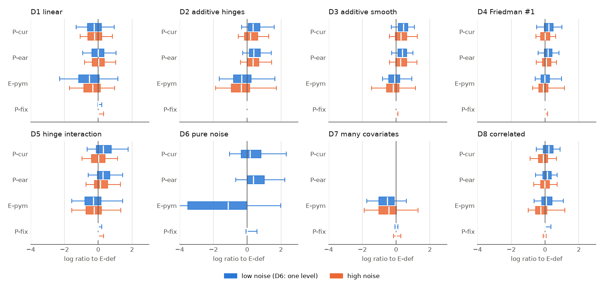
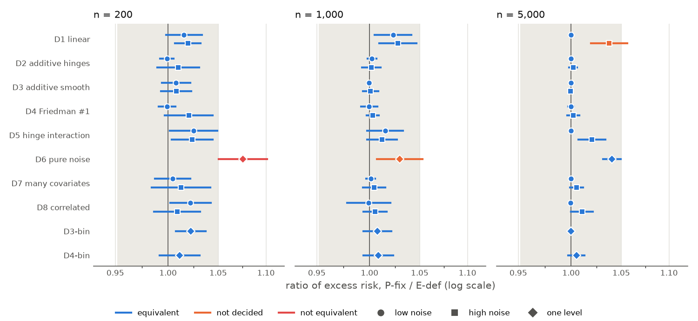
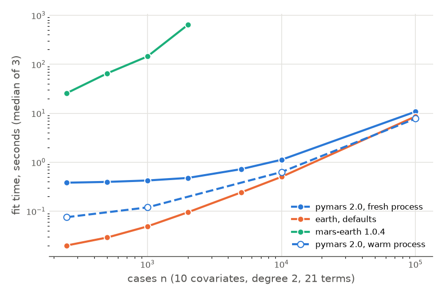

# Validation report for pymars 2.0

This report checks five claims about pymars 2.0, the rewrite in this fork, against the R package earth 5.3.4 and against the legacy pymars (the mars-earth 1.0.4 wheel). It follows the order of `VALIDATION_PLAN.md`, "Reporting, and what to offer upstream": conformance, gap, parity, sparsity and speed. Each claim has its own section with the design (ADEMP: aims, data-generating processes, estimands, methods, performance measures), the evidence, and a plain statement of what the evidence shows. Every table and figure says which claim it serves.

## The verdicts

| Claim | Verdict |
|---|---|
| [Conformance](#1-conformance): pymars reproduces earth's forward and pruning passes, except at documented rule differences and near-ties | Holds on the fixtures. 124 of 133 dataset fixtures and 197 of 200 random draws agree with earth in full; the other 12 comparisons show 7 labeled differences, none a bug, and the fast code shows exactly the same differences as the reference. |
| [Gap](#2-gap): the legacy pymars has a higher excess risk than earth when the truth has interactions, and the gap shrinks with earth's settings | Narrowed. At 200 cases and low noise the legacy code is 1.2 to 1.6 times worse than earth on every nonlinear DGP, additive ones included, and it stays worse on D3, D4 and D8 at 1,000 cases. Earth's settings do not close the gap, so the legacy code's rules cause most of it; on D8, and on D4 at 1,000 cases, the legacy settings alone give a part of it. |
| [Parity](#3-parity): pymars 2.0 is within a factor 1.05 of earth's excess risk on every cell | Holds with a condition. Equivalence is shown in 48 of 51 cells, 4 of them only after an extension of the cell that followed a failed interim look (optional stopping; see [Repetitions](#repetitions)). On pure noise pymars is worse than earth at every n, resolved above 1 at all three sizes: 7.6 percent at 200 cases (interval 1.051 to 1.101, a failure), 3.0 percent at 1,000 cases (not decided) and 4.0 percent at 5,000 cases (equivalent by a hair). D1 at 5,000 cases and high noise is not decided either. Where the two programs differ, pymars is slightly worse more often than not. |
| [Sparsity](#4-sparsity): on pure noise and with many irrelevant covariates, pymars selects no more terms and no more irrelevant covariates than earth | No resolved excess on D4, D7 and D8 (the claim has no margin, so this is the most a test can show). On pure noise pymars selects a few more terms and irrelevant covariates than earth at every n: 0.11 and 0.11 more per fit at 200 cases, 0.05 more irrelevant covariates at 1,000 and 0.09 and 0.08 at 5,000, small but resolved excesses that agree with the parity results there. |
| [Speed](#5-speed): pymars 2.0 fits within a stated factor of earth's time | At 10,000 cases, 10 covariates and degree 2, `EarthRegressor` with numba takes 1.7 times earth's time in a fresh process and 0.92 times in a warm one; the numpy code (Intel Macs, and the plan's target of 10 times "in pure numpy") takes 2.6 and 2.7 times. At 100,000 cases the numba path is faster than earth (0.76 and 0.67) and the numpy path 2.0 times slower. At 250 cases the numba path is 21 times slower than earth in a fresh process and 3.5 times in a warm one, because of a fixed cost per fit. |

No fit failed in any arm of the simulation ([failure counts](#failure-counts)).

## Versions and data

- pymars 2.0 (arm P-fix): the freeze commit `0274c5a` (branch `sim-freeze-1`; spec v3, numba 0.68.0 knot scan). The benchmark ran later, on `main` at `95212fa`, which adds the compiled forward-pass steps of K145c (#167) and the near-span fixes of #172. Speed work and fixes after the freeze change ordinary fits only at near-ties and in the last bits: the reviews of #159, #167 and #172 checked the changed code against the reference and against the previous `main` under the spec's tolerances. So the simulation results stand for the code on `main` at `95212fa`, and the speed numbers are those of that code.
- earth 5.3.4 on R 4.4.3. The legacy code: the mars-earth 1.0.4 wheel from PyPI (`validation/legacy/make_venv.sh`).
- Machine: Apple M1 Pro, 10 cores, macOS; Python 3.12.13, numpy 2.5.3. Every fit used one thread.
- Simulation results: `validation/sims/results/full/` (T21: P-fix and E-def, 94,500 fits) and `validation/sims/results/legacy/` (T04: the legacy arms, E-pym, OLS and HGB, 49,440 fits). The E-def fits are in both runs with the same seeds, and the 5,300 shared fits give identical values.
- Tables and figures: `validation/sims/report/make_report.py` builds them from those two `results.csv` files (`tables/`, `figures/`). The numbers in this report are copied from `tables/`.

## 1. Conformance

**Aim.** In matched comparisons, pymars takes the same forward steps and the same pruning path as earth and gives the same final model, except where a documented rule of the spec differs from earth on purpose, or at a near-tie, where two choices are equal up to rounding. A skeptic would reject the claim if a difference occurred that no spec rule explains.

**Data.** The fixtures in `validation/fixtures/`: 133 dataset fixtures (S01 to S20 in their modes: defaults, matched settings, raw units, weights, binary responses, degenerate data, degree 1 to 3) and the 200 random draws of S15, each fitted once by earth 5.3.4 through `Rscript`. `VALIDATION_PLAN.md`, "Test datasets", gives each dataset's purpose.

**Estimands.** For each fit: the term that each forward step adds, the RSS after each step, the termination code, the subsets of each size in pruning with their RSS and GCV, the selected terms, the coefficients, GCV, RSq, GRSq, the fitted values and the predictions.

**Methods.** Two implementations of `docs/algorithm.md`: the fast code (`pymars._core.fit_mars`) and the reference (`tests/reference/mars_ref.py`), which an agent wrote from the spec alone. `tests/test_conformance.py` compares each with earth.

**Performance measures.** Each difference from earth, with its label: `rule` (a documented rule that departs from earth), `quirk` (an earth behavior that pymars does not copy), `tie` (a near-tie: RSS values within 1e-7 of the RSS before the step), `numeric`, or `bug`. The tolerances are those of the plan's table: the forward terms exactly, the RSS values within 1e-8 relative plus the LA-5 terms, and so on (`validation/DIFFERENCES.md`, "What is compared").

**Evidence.** The table below counts the differences. It supports the claim if no difference has the label `bug`.

| Label | Entries | Comparisons |
|---|---|---|
| rule | 3 | 8 |
| quirk | 4 | 4 |
| tie | 0 | 0 |
| numeric | 0 | 0 |
| bug | 0 | 0 |

*Table 1.1. Differences between pymars and earth on 333 comparisons (133 dataset fixtures and 200 S15 draws, one whole fit each), the same for the fast code and the reference. Supports the conformance claim. `validation/DIFFERENCES.md` explains the entries E1 to E7 one by one.*

124 of the 133 dataset fixtures and 197 of the 200 draws agree with earth in full. The 3 `rule` entries are a constant response (E4: pymars reports gcv infinite and rsq 0, earth gcv 0 and rsq NaN) and earth's zeroing of sums of squares below about 1e-10 (E2, E3). The 4 `quirk` entries are earth's choice between a pair and a single hinge in raw units (E1) and earth's hidden term with `auto_linpreds=False` in 3 draws (E5 to E7). The fast code shows the same differences at the same steps as the reference, with the same candidate RSS values to 1e-8 (C07, PR #128; rechecked under spec v3 in PRs #160 to #162, and on `main` at `3e1aefc` for this report). The oracle tests compare the fast code with the reference on further random data: under spec v3, 0.4 percent of forward passes and 0.5 percent of whole fits stop at a near-tie, against the plan's limit of 5 percent (PR #160).

**Statement.** On the fixtures, pymars reproduces earth step by step, and every difference is a documented choice. The fixtures stay inside the spec's ordinary data except S10 (a near copy) and S12 (a covariate shifted by 3.2e6 times its spread), which still agree. Outside ordinary data (the spec's Limits, LIM-1 to LIM-4) the claim does not apply: the spec allows the two programs to differ there.

## The simulation study (claims 2 to 4)

The gap, parity and sparsity claims share one design, from `VALIDATION_PLAN.md`, "Statistical performance study". This section describes it once.

### Data-generating processes

Covariates are X ~ Unif[0, 1]^p, independent, with p = 10 unless stated. The outcome is Y = f(X) + σε with ε ~ N(0, 1). The noise σ is set so that the population R², Var f / (Var f + σ²), is 0.8 (low noise, `lo`) or 0.3 (high noise, `hi`); the values come from one draw of 10^6 cases (`validation/sims/diagnostics.json`). The two levels bracket an easy and a hard problem, because a DGP on which every method is perfect, or every method fails, cannot separate the methods.

| DGP | f(x) | sd(f) | Linear share of Var f | Why it is here |
|---|---|---|---|---|
| D1 linear | x1 + 2 x2 − x3 | 0.71 | 1.00 | A linear truth: MARS should add linear terms and stop |
| D2 additive hinges | 2 (x1 − 0.3)₊ − 3 (x1 − 0.7)₊ + 2 (0.5 − x2)₊ | 0.44 | 0.80 | A truth inside the MARS class; knot recovery |
| D3 additive smooth | sin(2π x1) + 2 (x2 − 0.5)² + exp(x3) | 0.87 | 0.71 | Curvature approximated by hinges |
| D4 Friedman #1 | 10 sin(π x1 x2) + 20 (x3 − 0.5)² + 10 x4 + 5 x5 | 4.88 | 0.75 | The standard benchmark: an interaction and 5 irrelevant covariates |
| D5 hinge interaction | 4 (x1 − 0.4)₊ (x2 − 0.5)₊ + x3 | 0.35 | 0.83 | An interaction inside the MARS class |
| D6 pure noise | 0, with σ = 1 (one noise level) | 0 | | Overfitting and pruning |
| D7 many covariates | D3 with p = 50 | 0.87 | 0.71 | Selection among 47 irrelevant covariates |
| D8 correlated | D4 with a Gaussian copula, latent correlation 0.6 (0.58 between the uniforms) | 6.47 | 0.87 | Collinearity and near-ties |
| D3-bin, D4-bin | Y ~ Bernoulli(expit(λ (f(X) − E f(X)))) with f of D3 or D4 | | | Binary outcomes, additive and with an interaction |

For the binary DGPs, λ is the largest scale that keeps the 1st and 99th percentiles of the true probability μ(X) inside [0.05, 0.95]: λ = 1.60 for D3-bin and 0.28 for D4-bin, which puts 41 and 45 percent of μ(X) in [0.3, 0.7]. The grid is fully factorial over DGP, sample size (200, 1,000 and 5,000 cases) and noise level: 51 cells. Each dataset's seed comes from its cell name and repetition number, so all arms see the same training and test data in a repetition, and a pilot's repetitions are the first repetitions of the full run.

### Methods (the arms)

| Arm | Settings | Why it is here |
|---|---|---|
| E-def | earth, `degree = 2`, all else at its defaults (penalty 3, `nk` = min(200, max(20, 2p)) + 1, `thresh = 0.001`, automatic spans, `fast.k = 20`, backward pruning); for binary outcomes `glm = list(family = binomial)` | The reference for every ratio |
| P-fix | pymars 2.0 `EarthRegressor(max_degree=2)` or `EarthClassifier(max_degree=2)`, all else at its defaults at the freeze (so `glm_alpha=0`; see the note under Binary outcomes) | The candidate (parity, sparsity) |
| P-cur | the 1.0.4 wheel, `Earth(max_degree=2)`, all else at its defaults | The library as users had it (gap) |
| P-ear | the 1.0.4 wheel with earth's settings where it has them: `penalty=1.5`, `minspan_alpha = endspan_alpha = 0.05` | Ablation: do the settings explain the gap? |
| E-pym | earth with the legacy code's settings: penalty 6, `thresh = 0`, `minspan = endspan = 1`, `fast.k = 0`, `Adjust.endspan = 1` | Ablation: earth moved to the legacy settings |
| EarthClassifier, GLMEarth | the 1.0.4 classifiers at their defaults (binary DGPs, 200 cases) | The legacy code for binary outcomes |

OLS and histogram gradient boosting (HGB) also ran as floors (T04). No claim here needs them, so this report does not show them; their numbers are in `validation/sims/results/legacy/summaries/`. The optional tuned arm of the plan did not run. All hyperparameters are fixed, because the claims are about each library at its defaults. The legacy arms did not run on D7 or at 5,000 cases, where one legacy fit takes 40 minutes or more (`VALIDATION_PLAN.md`, "Compute ledger").

### Estimands and performance measures

The estimand of each fit is its excess risk R(f̂) = E[(f̂(X) − f(X))²], the mean squared distance from the true regression function at a new X, estimated on a fresh test draw of 10,000 cases in each repetition. It equals the gain in held-out squared error over the true f, so lower is better. For binary outcomes it is the excess log loss E[KL(μ(X) ‖ μ̂(X))], with fitted probabilities clipped to [1e-6, 1 − 1e-6].

Two arms are compared by the paired log ratio g_i = log R_A,i − log R_B,i in repetition i. With n_sim repetitions, mean ḡ and standard deviation s_g, the report gives the ratio exp(ḡ), which is the ratio of the geometric means of the two excess risks, and the interval exp(ḡ ± 3 s_g/√n_sim): 3 Monte Carlo standard errors, the width that the decision rules use. The log scale turns the contrast into a ratio and tames the long right tail of squared errors.

- A difference contrast (the gap claim) is resolved when ḡ is at least 3 standard errors from 0. Resolved cells carry a `*` in the tables.
- An equivalence contrast (the parity claim) is shown when the whole interval lies inside [1/1.05, 1.05], that is when |ḡ| + 3 s_g/√n_sim ≤ log 1.05. It is a failure when the whole interval lies outside, and not decided otherwise.

The sparsity measures are the number of selected terms, whether a fit uses any irrelevant covariate, and how many it uses (on D4, D7 and D8 the irrelevant covariates are those that f does not use; on D6 every covariate is irrelevant). The binary table adds the calibration slope: the coefficient of a logistic regression of the test Y on logit(μ̂(X)), where 1 means good calibration.

### Repetitions

The legacy arms ran at the plan's caps: 300 repetitions at 200 cases and 200 at 1,000 cases (EarthClassifier 300, GLMEarth 20). GLMEarth ran 20 repetitions per binary cell only to confirm that it gives the same predictions as EarthClassifier in 1.0.4; it does, exactly, on all 40 (`validation/sims/results/legacy/README.md`), so its rows add no information beyond EarthClassifier's. Their pilot (`validation/sims/pilot_legacy.md`) showed that the caps resolve the large gaps but not every contrast; the gap tables show which.

P-fix and E-def ran at the size that a post-freeze pilot of 100 repetitions per cell asked for, by the plan's equivalence rule n_sim = (2·3·s_p / log 1.05)², rounded up to tiers of 300, 600, 1,300 and 3,000 (`validation/sims/results/full/pilot_sizing.csv`). Seven cells failed the equivalence rule in that run. A reviewer found most of them under-sized for the spread seen in the full run, and the seven were extended on the same frozen code, with nested seeds, to the larger of the plan's rule and the count needed at the observed gap: D1 at 1,000 cases (900 at high noise, 750 at low), D1 at 5,000 cases and high noise (400, then 600), D5 at 200 cases and low noise (900), D6 at 200 cases (7,500), D6 at 1,000 cases (3,300, then 3,800) and D6 at 5,000 cases (12,400).

These cells were extended because they had failed at an interim look, and two of them twice. That is a form of optional stopping: a cell that is extended after it fails has a higher chance to pass than the nominal rule gives. The sizes were fixed by the rule before each extension, and the 3-standard-error width keeps the error rate of one look small, but the four cells that passed only after an extension (D1 at 1,000 cases, both noise levels; D5 at 200 cases and low noise; D6 at 5,000 cases) are weaker evidence than the others. No further extension will run.

## 2. Gap

**Aim.** At their defaults, the legacy pymars (P-cur) has a higher excess risk than earth (E-def) when the truth has interactions (D4, D5, D8), and the gap shrinks when the legacy code runs with earth's settings (P-ear). The two ablations ask whether the settings or the rules cause the gap: if P-ear is close to E-def, or E-pym (earth with the legacy settings) is as bad as P-cur, the settings explain it.

**Design.** All regression DGPs at 200 cases and both noise levels, and D3, D4, D5 and D8 at 1,000 cases and low noise, to check that the gap persists at a larger n. Arms P-cur, P-ear and E-pym, each against E-def; P-fix is added on the same repetitions for comparison. Measures and decision rule as above.

**Evidence.** The ratio table at 200 cases and low noise is the main display. Values above 1 favor earth.

| DGP | P-cur / E-def | P-ear / E-def | E-pym / E-def | P-fix / E-def |
|---|---|---|---|---|
| D1 linear | 0.794* [0.702, 0.897] | 1.002 [0.903, 1.112] | 0.598* [0.493, 0.725] | 1.005 [0.973, 1.038] |
| D2 additive hinges | 1.575* [1.417, 1.750] | 1.611* [1.472, 1.764] | 0.822* [0.678, 0.998] | 0.999 [0.992, 1.005] |
| D3 additive smooth | 1.551* [1.422, 1.691] | 1.447* [1.353, 1.548] | 0.979 [0.873, 1.098] | 1.008 [0.994, 1.022] |
| D4 Friedman #1 | 1.251* [1.154, 1.357] | 1.191* [1.114, 1.274] | 1.142 [0.978, 1.332] | 0.999 [0.991, 1.007] |
| D5 hinge interaction | 1.527* [1.300, 1.794] | 1.392* [1.248, 1.553] | 0.793* [0.671, 0.937] | 1.027 [0.987, 1.068] |
| D6 pure noise | 1.374* [1.132, 1.667] | 1.742* [1.461, 2.077] | 0.159* [0.096, 0.264] | 1.023 [0.919, 1.139] |
| D7 many covariates | not run (too slow) | not run (too slow) | 0.600* [0.520, 0.691] | 1.004 [0.987, 1.022] |
| D8 correlated | 1.205* [1.118, 1.299] | 1.115* [1.038, 1.197] | 1.141* [1.028, 1.265] | 1.032* [1.001, 1.065] |

*Table 2.1. Ratio of excess risk to E-def (geometric means over 300 repetitions, 200 cases, low noise; D6 has one noise level), with ±3 Monte Carlo standard errors on the log scale; `*` marks a ratio at least 3 standard errors from 1. Supports the gap claim (first column) and tests its cause (the two ablation columns). P-fix uses the same 300 repetitions here, so its values differ slightly from the parity table.*

The first column shows the gap: the legacy code is worse than earth on every nonlinear DGP, by factors of 1.21 to 1.58, and better on the linear D1. The gap is as large on the additive D2 and D3 as on the interaction DGPs, so "when the truth has interactions" is the wrong condition. P-ear stays far from 1 on the same DGPs, so earth's settings do not repair the legacy code. Paired directly against P-cur (Table A.4), P-ear is better only on D8 (0.93) and worse on D1 and D6 (1.26 and 1.27), where earth's smaller penalty lets the legacy code overfit more. E-pym does not reproduce the gap either: earth with the legacy settings is as good as or better than earth at its defaults on most DGPs, and much better on D6 (0.16), where its larger penalty prunes the noise away. E-pym is resolved worse than E-def on D8 (1.14), and at 1,000 cases also on D4 (1.07) and D8 (1.16; Table A.3). On D8 at 1,000 cases that is about half of the legacy code's gap on the log scale (log 1.162 / log 1.319 = 0.54), so there the legacy settings alone explain a part of the gap.

At high noise (Table A.2) the gap stays on the additive DGPs (D2 1.33, D3 1.41) but is not resolved on the interaction DGPs (D4 1.02, D5 1.06, D8 0.91), where the pilot had already said that 300 repetitions could not separate them. At 1,000 cases (Table A.3) it persists on D3, D4 and D8 (1.28 to 1.38) and reverses on D5 (0.76).



*Figure 2.1. Per-repetition log ratio of excess risk against E-def at 200 cases, for P-cur, P-ear, E-pym and P-fix, by DGP; blue low noise, orange high noise; boxes are quartiles, whiskers the 5th and 95th percentiles; the axis is cut at −4 and 3 (D6's E-pym box runs further left). It shows whether a few bad fits drive the means of Table 2.1 and of Figure 3.1.*

The legacy arms' boxes are wide and shifted, so the gap is a shift of the whole distribution, and a few bad fits do not drive it. The P-fix boxes have collapsed to a line at 0, because 72 to 100 percent of P-fix fits give the same excess risk as earth to 1e-9 (the "equal fits" column of Table A.1).

**Statement.** The legacy pymars has a higher excess risk than earth on every nonlinear DGP at 200 cases and low noise, additive or not, by factors of 1.2 to 1.6, and on D3, D4 and D8 at 1,000 cases. Earth's settings do not close the gap, and earth with the legacy settings opens only a part of it, on D8 and on D4 at 1,000 cases, so the legacy code's rules and implementation cause most of the gap and its settings a part of it on D4 and D8. The claim therefore changes from "when the truth has interactions" to "when the truth is nonlinear", with the condition that at high noise and 200 cases only the additive DGPs show a resolved gap. pymars 2.0 has no such gap on the same repetitions (last column).

## 3. Parity

**Aim.** pymars 2.0 (P-fix) at its defaults (`glm_alpha=0`, the default at the freeze, for the binary cells) with `max_degree=2` has an excess risk within a factor of 1.05 of earth's (E-def), in either direction, on every cell of the grid, and an excess log loss within 5 percent on the binary DGPs. The plan named two likely boundaries: small samples with many irrelevant covariates, and correlated covariates.

**Design.** All 51 cells, P-fix against E-def, with 300 to 12,400 repetitions per cell as described under [Repetitions](#repetitions). The test is the equivalence rule with the margin log 1.05.

**Evidence.** The equivalence figure shows every cell.



*Figure 3.1. Ratio of excess risk (excess log loss for D3-bin and D4-bin), P-fix over E-def, with ±3 Monte Carlo standard errors, one row per DGP and one panel per sample size; the shaded band is the equivalence margin [1/1.05, 1.05]; circles low noise, squares high noise, diamonds one level; blue equivalent, orange not decided, red not equivalent. Supports the parity claim across the grid; Table A.1 has every value and the number of repetitions.*

Equivalence is shown in 48 of the 51 cells. The three other cells:

| DGP | noise | n | reps | P-fix / E-def | equal fits | decision |
|---|---|---|---|---|---|---|
| D1 linear | hi | 5,000 | 600 | 1.038 [1.019, 1.056] | 81% | not decided |
| D6 pure noise | na | 200 | 7,500 | 1.076 [1.051, 1.101] | 85% | not equivalent |
| D6 pure noise | na | 1,000 | 3,800 | 1.030 [1.007, 1.053] | 78% | not decided |

*Table 3.1. The cells where equivalence is not shown, from Table A.1. "equal fits" is the share of repetitions where the two excess risks agree to 1e-9. These cells limit the parity claim.*

- **D6 at 200 cases is a failure.** On pure noise pymars is 7.6 percent worse than earth, and the whole interval [1.051, 1.101] lies above the margin. With 7,500 repetitions it is one of the most precise cells in the study.
- **D1 at 5,000 cases and high noise is not decided** at its 600 repetitions. The interval [1.019, 1.056] crosses the upper margin; at the observed spread about 1,300 repetitions would decide it.
- **D6 at 1,000 cases is not decided** at its 3,800 repetitions. The interval [1.007, 1.053] crosses the upper margin; about 5,000 repetitions would decide it.

Two patterns stand out. First, the cells off the margin are on D6 and D1, the DGPs with the least nonlinear signal, and not where the plan expected them: D7 with many covariates and D8 with correlated covariates pass at every n. Second, the differences lean one way. In 46 of the 51 cells the two programs differ in at least one repetition; in 38 of those 46 pymars has the larger excess risk, the interval lies wholly above 1 in 12, and wholly below 1 in none. In the equivalent cells the lean is at most about 3 percent, apart from D6 at 5,000 cases (4.0 percent).

The fits differ in a minority of repetitions (a median of 11 percent of repetitions per cell, at most 28 percent for the regression DGPs), and the ratio comes from those. On D6 at 200 cases the fits differ in 15 percent of repetitions; in those, pymars has more terms than earth in 53 percent, fewer in 29 percent, and the larger excess risk in 69 percent. On the binary DGPs the share of equal fits is lower (46 to 63 percent) because the logistic refits of the same terms differ in the last digits; the ratios there are still within 2.2 percent.

This study does not show which rule makes pymars keep more terms on noise. The documented differences (`docs/differences.md`) include the scaling of the pair rule by the covariates' variance (LA-7, E1) and the fixed tie order, and either could act on pure noise, where many candidates have nearly equal small gains. A comparison of the forward passes in the differing D6 repetitions would settle it; that is left as a follow-up.

**Statement.** pymars 2.0 at its defaults (`glm_alpha=0`, the default at the freeze, for the binary cells) matches earth's excess risk within 5 percent on 48 of 51 cells, including every interaction, many-covariate, correlated-covariate and binary cell. The claim gains a condition: on pure noise pymars is worse than earth at every sample size, resolved above 1 at all three. At 200 cases it is 5 to 10 percent worse; at 1,000 cases the study cannot tell whether the gap is inside 5 percent; at 5,000 cases it is inside 5 percent only by a small margin (|ḡ| + 3 standard errors = 0.0484 against log 1.05 = 0.0488) and only after the extension to 12,400 repetitions. On the linear DGP at 5,000 cases and high noise the study cannot tell either. Where the two programs differ, pymars is the worse of the two more often than not, by a few percent. On pure noise both excess risks are small, so the ratio is one of two small numbers.

## 4. Sparsity

**Aim.** On pure noise and with many irrelevant covariates, pymars selects no more terms and no more irrelevant covariates than earth. Overfitting shows most at small n, so the cells are D4, D6, D7 and D8 at 200 cases.

**Design.** The repetitions of the parity and gap runs; no extra fits. For P-fix and P-cur the per-repetition differences from E-def are paired, and their means get ±3 Monte Carlo standard errors.

**Evidence.**

| DGP | noise | arm | terms, median (IQR) | uses an irrelevant covariate | irrelevant covariates, mean | minus E-def: terms / irrelevant covariates |
|---|---|---|---|---|---|---|
| D4 Friedman #1 | lo | E-def | 14 (13 to 15) | 77% | 1.06 |  |
| D4 Friedman #1 | lo | P-cur | 15 (13 to 16) | 100% | 2.83 | +0.69 [+0.21, +1.17] / +1.77 [+1.56, +1.98] |
| D4 Friedman #1 | lo | P-fix | 14 (13 to 15) | 76% | 1.05 | +0.03 [-0.03, +0.08] / -0.01 [-0.03, +0.01] |
| D4 Friedman #1 | hi | E-def | 10 (8 to 11) | 88% | 1.52 |  |
| D4 Friedman #1 | hi | P-cur | 11 (9 to 13) | 100% | 3.27 | +1.41 [+0.82, +2.00] / +1.75 [+1.52, +1.98] |
| D4 Friedman #1 | hi | P-fix | 10 (8 to 11) | 88% | 1.54 | +0.08 [-0.06, +0.22] / +0.02 [-0.03, +0.08] |
| D6 pure noise | na | E-def | 4 (3 to 7) | 92% | 3.41 |  |
| D6 pure noise | na | P-cur | 9 (7 to 11) | 100% | 6.56 | +4.00 [+3.32, +4.67] / +3.12 [+2.73, +3.50] |
| D6 pure noise | na | P-fix | 5 (3 to 7) | 92% | 3.52 | +0.11 [+0.07, +0.15] / +0.11 [+0.09, +0.14] |
| D7 many covariates | lo | E-def | 22 (20 to 25) | 100% | 10.17 |  |
| D7 many covariates | lo | P-fix | 22 (20 to 25) | 100% | 10.15 | -0.05 [-0.41, +0.31] / -0.02 [-0.23, +0.19] |
| D7 many covariates | hi | E-def | 19 (16 to 23) | 100% | 10.41 |  |
| D7 many covariates | hi | P-fix | 20 (16 to 23) | 100% | 10.51 | +0.14 [-0.33, +0.62] / +0.11 [-0.17, +0.39] |
| D8 correlated | lo | E-def | 13 (11 to 14) | 80% | 1.28 |  |
| D8 correlated | lo | P-cur | 14 (13 to 16) | 99% | 2.88 | +1.65 [+1.16, +2.14] / +1.62 [+1.41, +1.83] |
| D8 correlated | lo | P-fix | 13 (11 to 14) | 81% | 1.30 | +0.07 [-0.01, +0.15] / +0.01 [-0.03, +0.05] |
| D8 correlated | hi | E-def | 8 (6 to 10) | 86% | 1.78 |  |
| D8 correlated | hi | P-cur | 11 (9 to 12) | 100% | 3.25 | +2.45 [+1.88, +3.02] / +1.53 [+1.31, +1.76] |
| D8 correlated | hi | P-fix | 8 (6 to 10) | 87% | 1.79 | -0.01 [-0.15, +0.12] / +0.01 [-0.04, +0.07] |

*Table 4.1. Model size and selection at 200 cases: the median number of terms (intercept included) with its interquartile range, the share of fits that use any irrelevant covariate, the mean number of irrelevant covariates used, and the mean paired difference from E-def with ±3 Monte Carlo standard errors. 300 repetitions (D6: 7,500 for P-fix and E-def and 300 for P-cur; D8: 600 for P-fix and E-def). P-cur did not run on D7. Supports the sparsity claim.*

The legacy code is much less sparse than earth: on pure noise it selects 4 more terms and 3 more irrelevant covariates per fit, and on D4 and D8 it uses an irrelevant covariate in nearly every fit. pymars 2.0 shows no resolved excess on D4, D7 and D8, where every interval covers 0. On D6 it selects 0.11 more terms and 0.11 more irrelevant covariates per fit than earth (intervals [+0.07, +0.15] and [+0.09, +0.14]). Earth's model on noise has a median of 4 terms, so the excess is about 3 percent of the model size, and it agrees with the parity failure in the same cell: more noise terms give a larger excess risk.

**Statement.** When the truth has signal, also with 47 irrelevant covariates and with correlated covariates, the study finds no resolved excess of pymars 2.0 over earth in terms or in irrelevant covariates; the claim has no margin, so it cannot show more than that, and on D7 the intervals are wide (for example [−0.33, +0.62] terms at high noise). On pure noise pymars keeps slightly more terms than earth at every sample size: at 200 cases about one more term in every nine fits, at 1,000 cases 0.05 more irrelevant covariates per fit ([+0.02, +0.09]; terms +0.05 [−0.00, +0.10]), and at 5,000 cases 0.09 more terms ([+0.06, +0.12]) and 0.08 more irrelevant covariates ([+0.06, +0.10]). So the claim holds with that condition. The legacy code kept far more.

## 5. Speed

**Aim.** pymars 2.0 fits within a stated factor of earth's time. The plan's target was 10 times earth's time at 10,000 cases, 10 covariates and degree 2, "in pure numpy" (`VALIDATION_PLAN.md`, "Fast path"; definition of done, item 5). Since then numba became a dependency where it has wheels, so the report states both paths: numba, which most users run, and the numpy code, which Intel Macs run and which the target names.

**Design.** The benchmark of `validation/bench/` (`VALIDATION_PLAN.md`, "Benchmark design"): Friedman #1 data with fixed seeds, one factor at a time around 1,000 cases, 10 covariates, degree 2 and a limit of 21 terms; cases from 250 to 100,000. Each point is the median of 3 runs, each in a fresh process with one thread, 4 cells at a time. pymars runs `EarthRegressor` and the internal `fit_mars` with numba; earth runs at its defaults and with `fast.k = 0`; the legacy code runs up to 2,000 cases (its times are from the T19 run at `ae9d199`, since that code does not change). The timer covers the fit alone, after the imports and the data loading. In a fresh process it still includes pymars' first-call costs, about 0.3 s, mostly loading numba's compiled code from its disk cache. So `validation/sims/report/warm_times.py` also times the first fit of a fresh process and the median of 3 later fits in the same process, as in cross-validation or a simulation, for the numba path and, with `pymars._kernels.ENABLED = False`, for the numpy path.

**Evidence.**



*Figure 5.1. Fit time against the number of cases, log-log, at 10 covariates, degree 2 and 21 terms: pymars 2.0 `EarthRegressor` (numba) in a fresh and in a warm process, earth at its defaults, and the legacy 1.0.4 code (up to 2,000 cases). Supports the speed claim. Table 5.1 adds the numpy path.*

| Cases | earth defaults (s) | numba, fresh (s) | numba, warm (s) | numpy, fresh (s) | numpy, warm (s) | Factor: numba fresh / warm | Factor: numpy fresh / warm | legacy 1.0.4 (s) |
|---|---|---|---|---|---|---|---|---|
| 250 | 0.018 | 0.373 | 0.063 | 0.150 | 0.148 | 21 / 3.5 | 8.3 / 8.2 | 25.8 |
| 1,000 | 0.049 | 0.388 | 0.094 | 0.244 | 0.238 | 7.9 / 1.9 | 5.0 / 4.9 | 144 |
| 10,000 | 0.464 | 0.809 | 0.425 | 1.22 | 1.26 | 1.7 / 0.92 | 2.6 / 2.7 | not run |
| 100,000 | 7.57 | 5.77 | 5.09 | 15.3 | 15.3 | 0.76 / 0.67 | 2.0 / 2.0 | not run |

*Table 5.1. Fit times of `EarthRegressor` and earth, and their ratio, at 10 covariates, degree 2 and 21 terms, on `main` at `95212fa`. Earth and numba fresh: median of 3 fresh processes in the benchmark (`validation/bench/REPORT.md`). numba warm, numpy fresh and numpy warm: `warm_times.py` (`warm_times.csv`, `warm_times_numpy.csv`), where "fresh" is the first fit of a fresh process and "warm" the median of 3 later fits; it ran one size at a time, while the benchmark ran 4 cells at a time. At 10,000 cases the first numba fit of the script took 0.69 s against 0.81 s in the benchmark, so the run conditions differ by about 15 percent, and a factor near 1 means "about equal". Supports the speed claim.*

At the plan's point, 10,000 cases, the numpy path takes 2.6 times earth's time in a fresh process and 2.7 times in a warm one, so the target of 10 "in pure numpy" is met. With numba, `EarthRegressor` takes 1.7 times earth's time in a fresh process (0.81 s against 0.46 s) and about the same time in a warm one (0.92 times); the internal `fit_mars` also takes 1.7 times. At 100,000 cases the numba path is faster than earth (5.8 s fresh and 5.1 s warm against 7.6 s), and the numpy path takes 2.0 times earth's time. At small n a fixed cost dominates the numba path: about 0.3 s more in the first fit of a process, and about 0.06 s per fit in a warm one, against earth's 0.02 s at 250 cases. The numpy path has no cache to load, so its first fit costs no more than the later ones, and below about 1,000 cases it is faster than the numba path in a fresh process. Against the legacy code, pymars 2.0 is 69 times faster at 250 cases and 1,400 times faster at 2,000 cases. From 10,000 to 100,000 cases the numba time grows by a factor of 7.1, a little less than linearly in n (`validation/bench/REPORT.md` has the other factors). With weights, pymars takes 0.45 s at 1,000 cases, where earth takes 16 s.

**Statement.** At 10,000 cases, 10 covariates and degree 2, pymars 2.0 fits within 2.7 times earth's time on the numpy path, which meets the plan's target of 10, and within 1.7 times with numba, or in about the same time in a warm process. At 100,000 cases the numba path is faster than earth and the numpy path 2.0 times slower. At a few hundred cases earth is 3.5 to 21 times faster than the numba path, because of a fixed cost of about 0.06 s per fit and about 0.3 s more in the first fit of a process. The legacy code was 69 to 1,400 times slower (250 to 2,000 cases).

## Failure counts

| arm | fits attempted | failed |
|---|---|---|
| E-def | 47,250 | 0 |
| E-pym | 5,300 | 0 |
| EarthClassifier | 600 | 0 |
| GLMEarth | 40 | 0 |
| HGB | 15,300 | 0 |
| OLS | 13,500 | 0 |
| P-cur | 4,700 | 0 |
| P-ear | 4,700 | 0 |
| P-fix | 47,250 | 0 |

*Fits attempted and failed per arm. E-def counts the T21 run only; the 5,300 E-def fits of the T04 run repeat the same seeds and also had no failure (`validation/sims/results/full/failure_counts.csv` and `validation/sims/results/legacy/failure_counts.csv` give them per cell). Every number in this report comes from completed fits, and none failed.*

## Binary outcomes

The binary DGPs belong to the parity claim. This table adds the legacy classifiers and the calibration slope, which measures the effect of the legacy code's penalized refit (F9 in the plan).

| DGP | n | arm | reps | excess log loss / E-def | calibration slope, median |
|---|---|---|---|---|---|
| D3-bin | 200 | E-def | 1,300 | 1 (reference) | 0.44 |
| D3-bin | 200 | EarthClassifier | 300 | 0.520* [0.467, 0.578] | 1.11 |
| D3-bin | 200 | GLMEarth | 20 | 0.760 [0.418, 1.380] | 1.11 |
| D3-bin | 200 | P-fix | 1,300 | 1.022* [1.008, 1.037] | 0.43 |
| D3-bin | 1,000 | E-def | 300 | 1 (reference) | 0.78 |
| D3-bin | 1,000 | P-fix | 300 | 1.008 [0.994, 1.021] | 0.78 |
| D3-bin | 5,000 | E-def | 300 | 1 (reference) | 0.96 |
| D3-bin | 5,000 | P-fix | 300 | 1.000 [1.000, 1.000] | 0.96 |
| D4-bin | 200 | E-def | 300 | 1 (reference) | 0.36 |
| D4-bin | 200 | EarthClassifier | 300 | 0.365* [0.336, 0.396] | 1.10 |
| D4-bin | 200 | GLMEarth | 20 | 0.404* [0.277, 0.587] | 0.98 |
| D4-bin | 200 | P-fix | 300 | 1.011 [0.992, 1.031] | 0.36 |
| D4-bin | 1,000 | E-def | 300 | 1 (reference) | 0.78 |
| D4-bin | 1,000 | P-fix | 300 | 1.009 [0.994, 1.023] | 0.78 |
| D4-bin | 5,000 | E-def | 300 | 1 (reference) | 0.95 |
| D4-bin | 5,000 | P-fix | 300 | 1.005 [0.997, 1.013] | 0.95 |

*Table 6.1. Ratio of excess log loss to E-def with ±3 Monte Carlo standard errors (`*` resolved at 3 standard errors) and the median calibration slope on the test set (1 is well calibrated). Supports the parity claim for binary outcomes and measures the effect of the legacy penalized refit.*

pymars 2.0 matches earth on all six binary cells (Figure 3.1), and its calibration matches earth's at every n. Both are overconfident at 200 cases (slopes 0.36 to 0.44) and close to calibrated at 5,000 cases (0.95 and 0.96), as expected of an unpenalized logistic refit of a selected basis. At 200 cases the legacy EarthClassifier has 0.37 to 0.52 of earth's excess log loss, and the legacy classifiers have slopes near 1. Their penalized refit, which shrinks the coefficients, is a likely cause; no ablation here tests it, and the legacy forward pass differs too. Both programs follow their documented method here. pymars 2.0 offers the penalty as `glm_alpha`. The binary part of the parity claim is about earth, and it holds.

**Note on the default of `glm_alpha` (issue #175).** The simulation and the conformance fixtures used `glm_alpha=0`, earth's unpenalized refit and the default at the freeze. The default is now 1, the strength of scikit-learn's `LogisticRegression` at `C=1`, because at 0 the refit warns on scikit-learn's breast_cancer, iris and wine data. The parity claim for binary outcomes holds at `glm_alpha=0`, the earth-compatible setting. No number in this report changed.

## Appendix

### A.1 Every parity cell

| DGP | noise | n | reps | P-fix / E-def | equal fits | decision |
|---|---|---|---|---|---|---|
| D1 linear | hi | 200 | 3,000 | 1.019 [1.007, 1.032] | 86% | equivalent |
| D1 linear | hi | 1,000 | 900 | 1.028 [1.010, 1.047] | 81% | equivalent |
| D1 linear | hi | 5,000 | 600 | 1.038 [1.019, 1.056] | 81% | not decided |
| D1 linear | lo | 200 | 1,300 | 1.016 [0.998, 1.033] | 87% | equivalent |
| D1 linear | lo | 1,000 | 750 | 1.023 [1.005, 1.042] | 82% | equivalent |
| D1 linear | lo | 5,000 | 300 | 1.000 [1.000, 1.000] | 100% | equivalent |
| D2 additive hinges | hi | 200 | 300 | 1.010 [0.990, 1.031] | 92% | equivalent |
| D2 additive hinges | hi | 1,000 | 300 | 1.002 [0.993, 1.011] | 93% | equivalent |
| D2 additive hinges | hi | 5,000 | 300 | 1.002 [0.998, 1.006] | 98% | equivalent |
| D2 additive hinges | lo | 200 | 300 | 0.999 [0.992, 1.005] | 97% | equivalent |
| D2 additive hinges | lo | 1,000 | 300 | 1.002 [0.998, 1.007] | 97% | equivalent |
| D2 additive hinges | lo | 5,000 | 300 | 1.000 [1.000, 1.000] | 100% | equivalent |
| D3 additive smooth | hi | 200 | 300 | 1.008 [0.993, 1.023] | 89% | equivalent |
| D3 additive smooth | hi | 1,000 | 300 | 1.001 [0.994, 1.009] | 97% | equivalent |
| D3 additive smooth | hi | 5,000 | 300 | 1.000 [0.998, 1.001] | 99% | equivalent |
| D3 additive smooth | lo | 200 | 300 | 1.008 [0.994, 1.022] | 97% | equivalent |
| D3 additive smooth | lo | 1,000 | 300 | 0.999 [0.998, 1.001] | 99% | equivalent |
| D3 additive smooth | lo | 5,000 | 300 | 1.000 [1.000, 1.000] | 100% | equivalent |
| D3-bin | na | 200 | 1,300 | 1.022 [1.008, 1.037] | 61% | equivalent |
| D3-bin | na | 1,000 | 300 | 1.008 [0.994, 1.021] | 46% | equivalent |
| D3-bin | na | 5,000 | 300 | 1.000 [1.000, 1.000] | 56% | equivalent |
| D4 Friedman #1 | hi | 200 | 300 | 1.020 [0.997, 1.045] | 90% | equivalent |
| D4 Friedman #1 | hi | 1,000 | 300 | 1.003 [0.997, 1.009] | 94% | equivalent |
| D4 Friedman #1 | hi | 5,000 | 300 | 1.002 [0.996, 1.008] | 95% | equivalent |
| D4 Friedman #1 | lo | 200 | 300 | 0.999 [0.991, 1.007] | 95% | equivalent |
| D4 Friedman #1 | lo | 1,000 | 300 | 1.000 [0.992, 1.008] | 94% | equivalent |
| D4 Friedman #1 | lo | 5,000 | 300 | 1.000 [0.997, 1.002] | 91% | equivalent |
| D4-bin | na | 200 | 300 | 1.011 [0.992, 1.031] | 63% | equivalent |
| D4-bin | na | 1,000 | 300 | 1.009 [0.994, 1.023] | 48% | equivalent |
| D4-bin | na | 5,000 | 300 | 1.005 [0.997, 1.013] | 59% | equivalent |
| D5 hinge interaction | hi | 200 | 1,300 | 1.024 [1.004, 1.045] | 83% | equivalent |
| D5 hinge interaction | hi | 1,000 | 600 | 1.012 [0.998, 1.027] | 87% | equivalent |
| D5 hinge interaction | hi | 5,000 | 600 | 1.020 [1.007, 1.034] | 89% | equivalent |
| D5 hinge interaction | lo | 200 | 900 | 1.025 [1.002, 1.049] | 87% | equivalent |
| D5 hinge interaction | lo | 1,000 | 600 | 1.015 [0.998, 1.033] | 89% | equivalent |
| D5 hinge interaction | lo | 5,000 | 300 | 1.000 [1.000, 1.000] | 100% | equivalent |
| D6 pure noise | na | 200 | 7,500 | 1.076 [1.051, 1.101] | 85% | not equivalent |
| D6 pure noise | na | 1,000 | 3,800 | 1.030 [1.007, 1.053] | 78% | not decided |
| D6 pure noise | na | 5,000 | 12,400 | 1.040 [1.031, 1.050] | 77% | equivalent |
| D7 many covariates | hi | 200 | 300 | 1.013 [0.984, 1.042] | 72% | equivalent |
| D7 many covariates | hi | 1,000 | 300 | 1.005 [0.994, 1.016] | 86% | equivalent |
| D7 many covariates | hi | 5,000 | 300 | 1.005 [0.999, 1.012] | 87% | equivalent |
| D7 many covariates | lo | 200 | 300 | 1.004 [0.987, 1.022] | 80% | equivalent |
| D7 many covariates | lo | 1,000 | 300 | 1.001 [0.997, 1.006] | 91% | equivalent |
| D7 many covariates | lo | 5,000 | 300 | 1.000 [1.000, 1.000] | 100% | equivalent |
| D8 correlated | hi | 200 | 600 | 1.009 [0.986, 1.032] | 84% | equivalent |
| D8 correlated | hi | 1,000 | 300 | 1.005 [0.994, 1.017] | 87% | equivalent |
| D8 correlated | hi | 5,000 | 300 | 1.011 [1.000, 1.022] | 93% | equivalent |
| D8 correlated | lo | 200 | 600 | 1.022 [1.002, 1.042] | 87% | equivalent |
| D8 correlated | lo | 1,000 | 300 | 0.999 [0.978, 1.020] | 84% | equivalent |
| D8 correlated | lo | 5,000 | 300 | 0.999 [0.997, 1.001] | 100% | equivalent |

*Table A.1. P-fix over E-def in every cell, with ±3 Monte Carlo standard errors, the number of repetitions, the share of repetitions with equal excess risk (to 1e-9), and the equivalence decision at the margin 1.05. Supports the parity claim. The same numbers are in `validation/sims/results/full/parity.csv`. The cells where every fit is equal have intervals of width 0. D6 at 5,000 cases rounds to an upper bound of 1.050; its exact upper bound is 1.0495, 0.0004 inside the margin on the log scale, after an extension.*

### A.2 The gap at high noise, 200 cases

| DGP | P-cur / E-def | P-ear / E-def | E-pym / E-def | P-fix / E-def |
|---|---|---|---|---|
| D1 linear | 0.843* [0.757, 0.939] | 1.037 [0.935, 1.150] | 0.739* [0.622, 0.878] | 1.018 [0.965, 1.073] |
| D2 additive hinges | 1.329* [1.194, 1.480] | 1.493* [1.349, 1.652] | 0.800 [0.614, 1.041] | 1.010 [0.990, 1.031] |
| D3 additive smooth | 1.406* [1.277, 1.549] | 1.389* [1.276, 1.513] | 0.841* [0.742, 0.955] | 1.008 [0.993, 1.023] |
| D4 Friedman #1 | 1.023 [0.938, 1.116] | 1.077* [1.009, 1.149] | 0.998 [0.892, 1.117] | 1.020 [0.997, 1.045] |
| D5 hinge interaction | 1.062 [0.912, 1.236] | 1.207* [1.080, 1.350] | 0.816* [0.690, 0.964] | 1.036 [0.995, 1.079] |
| D7 many covariates | not run (too slow) | not run (too slow) | 0.651* [0.546, 0.776] | 1.013 [0.984, 1.042] |
| D8 correlated | 0.913 [0.820, 1.016] | 1.004 [0.930, 1.084] | 0.881 [0.754, 1.029] | 1.001 [0.974, 1.029] |

*Table A.2. As Table 2.1 at high noise (population R² 0.3), 300 repetitions. Supports the high-noise condition of the gap claim.*

### A.3 The gap at 1,000 cases, low noise

| DGP | P-cur / E-def | P-ear / E-def | E-pym / E-def | P-fix / E-def |
|---|---|---|---|---|
| D3 additive smooth | 1.376* [1.293, 1.464] | 1.276* [1.209, 1.346] | 0.954 [0.847, 1.075] | 0.999 [0.997, 1.002] |
| D4 Friedman #1 | 1.281* [1.202, 1.366] | 1.109* [1.053, 1.168] | 1.067* [1.012, 1.126] | 0.999 [0.988, 1.009] |
| D5 hinge interaction | 0.757* [0.672, 0.853] | 0.973 [0.864, 1.095] | 0.694* [0.556, 0.866] | 1.009 [0.977, 1.042] |
| D8 correlated | 1.319* [1.200, 1.449] | 1.128* [1.045, 1.217] | 1.162* [1.014, 1.333] | 1.002 [0.975, 1.030] |

*Table A.3. As Table 2.1 at 1,000 cases and low noise, 200 repetitions; the four cells that the plan runs for the legacy code at this size. Supports the claim that the gap persists at a larger n.*

### A.4 Settings of the legacy code

| DGP | noise | n | P-ear / P-cur |
|---|---|---|---|
| D1 linear | lo | 200 | 1.263* [1.159, 1.376] |
| D2 additive hinges | lo | 200 | 1.023 [0.954, 1.098] |
| D3 additive smooth | lo | 200 | 0.933 [0.869, 1.001] |
| D4 Friedman #1 | lo | 200 | 0.952 [0.889, 1.019] |
| D5 hinge interaction | lo | 200 | 0.912 [0.784, 1.060] |
| D6 pure noise | na | 200 | 1.268* [1.141, 1.410] |
| D8 correlated | lo | 200 | 0.925* [0.878, 0.974] |
| D1 linear | hi | 200 | 1.230* [1.140, 1.326] |
| D2 additive hinges | hi | 200 | 1.123* [1.046, 1.206] |
| D3 additive smooth | hi | 200 | 0.988 [0.921, 1.060] |
| D4 Friedman #1 | hi | 200 | 1.052 [0.974, 1.137] |
| D5 hinge interaction | hi | 200 | 1.137 [1.000, 1.292] |
| D8 correlated | hi | 200 | 1.100 [0.997, 1.213] |
| D3 additive smooth | lo | 1,000 | 0.927* [0.878, 0.979] |
| D4 Friedman #1 | lo | 1,000 | 0.866* [0.814, 0.920] |
| D5 hinge interaction | lo | 1,000 | 1.284* [1.178, 1.400] |
| D8 correlated | lo | 1,000 | 0.855* [0.793, 0.922] |

*Table A.4. The legacy code with earth's settings over the legacy code at its defaults, paired by repetition. Tests the second half of the gap claim, that earth's settings shrink the gap: they shrink it by 7 to 15 percent in the 5 resolved cells below 1 and enlarge it in the 5 resolved cells above 1.*

### A.5 Binary outcomes: excess Brier score and clipped probabilities

| DGP | n | arm | excess Brier score / E-def | clipped probabilities per fit, mean (share of fits with any) |
|---|---|---|---|---|
| D3-bin | 200 | E-def | 1 (reference) | 9.6 (15%) |
| D3-bin | 200 | EarthClassifier | 0.782* [0.720, 0.849] | 0.0 (0%) |
| D3-bin | 200 | GLMEarth | 1.059 [0.643, 1.744] | 0.0 (0%) |
| D3-bin | 200 | P-fix | 1.011* [1.002, 1.020] | 12.1 (17%) |
| D3-bin | 1,000 | E-def | 1 (reference) | 1.1 (5%) |
| D3-bin | 1,000 | P-fix | 1.002 [0.995, 1.010] | 1.3 (5%) |
| D3-bin | 5,000 | E-def | 1 (reference) | 0.0 (0%) |
| D3-bin | 5,000 | P-fix | 1.000* [1.000, 1.000] | 0.0 (0%) |
| D4-bin | 200 | E-def | 1 (reference) | 10.3 (15%) |
| D4-bin | 200 | EarthClassifier | 0.525* [0.495, 0.558] | 0.0 (0%) |
| D4-bin | 200 | GLMEarth | 0.595* [0.454, 0.779] | 0.0 (0%) |
| D4-bin | 200 | P-fix | 1.003 [0.990, 1.015] | 11.6 (17%) |
| D4-bin | 1,000 | E-def | 1 (reference) | 0.5 (2%) |
| D4-bin | 1,000 | P-fix | 1.005 [0.994, 1.017] | 0.5 (2%) |
| D4-bin | 5,000 | E-def | 1 (reference) | 0.0 (0%) |
| D4-bin | 5,000 | P-fix | 1.004 [0.998, 1.010] | 0.0 (0%) |

*Table A.5. The excess Brier score E[(μ̂(X) − μ(X))²] as a ratio to E-def with ±3 Monte Carlo standard errors (`*` resolved), and the number of fitted probabilities clipped to [1e-6, 1 − 1e-6] per fit (out of 10,000 test points), with the share of fits that clip any. The plan's "Performance measures" asks for both. The excess Brier score tells the same story as the excess log loss in Table 6.1. Earth and pymars 2.0 clip a few probabilities per fit at 200 cases (in 15 to 17 percent of fits) and almost none at 5,000; the clipped values enter the excess log loss at the clipping bound. The clipped counts come from the per-repetition files of the runs (`tables/clipped.csv`), since `results.csv` does not hold them.*

### A.6 How to rebuild

```sh
. dev/env.sh
uv run --frozen --group validation python validation/sims/report/make_report.py \
    --bench-run <a run folder of validation/bench/run.py> \
    --run-dirs <the T21 run folder> <the T04 run folder>
NUMBA_NUM_THREADS=1 nice -n 15 uv run --frozen --group validation python \
    validation/sims/report/warm_times.py --out validation/sims/report/warm_times.csv
NUMBA_NUM_THREADS=1 nice -n 15 uv run --frozen --group validation python \
    validation/sims/report/warm_times.py --numpy --out validation/sims/report/warm_times_numpy.csv
```

Without `--bench-run` the script uses the stored `validation/sims/report/bench_times.csv`, and without `--run-dirs` the stored `tables/clipped.csv`. The run folders of this report were `.worktrees/runner-t21/validation/runs/full` and `.worktrees/runner-legacy/validation/runs/legacy_full` (ignored by git). The simulation runs are described in `validation/sims/README.md`, `validation/sims/results/legacy/README.md` and `validation/sims/results/full/summary.md`, and the benchmark in `validation/bench/README.md`.
